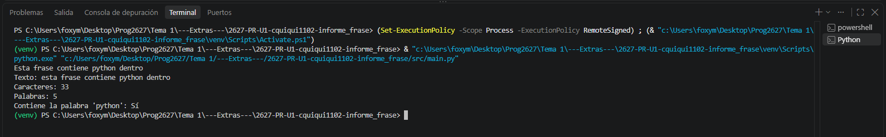
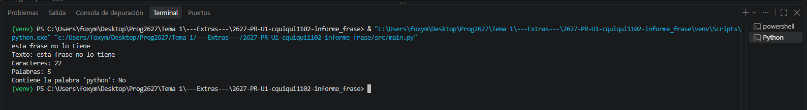

## 1. Informe de una frase
**Desarrolla un programa que lea una frase y muestre una versión normalizada junto con algunos datos sobre ella.**

---

## Funciones que debes implementar:

**preparar_texto(frase):** elimina los espacios de los extremos y convierte el texto a minúsculas. Devuelve el texto preparado.

**analizar_texto(frase):** recibe el texto preparado y devuelve una tupla con tres datos: número de caracteres —incluidos los espacios interiores—, número de palabras y si contiene la palabra completa "python". Para obtener las palabras, utiliza split().

La función **main()** debe leer la frase, llamar a **preparar_texto()** y comprobar si el resultado está vacío. Si está vacío, mostrará un mensaje de error. En caso contrario, llamará a **analizar_texto()**, desempaquetará la tupla y mostrará el informe.

---

## Ejemplo:

**Entrada:** 
  Aprender PYTHON es divertido   

**Salida:** 
Texto: aprender python es divertido 
Caracteres: 28 
Palabras: 4 
Contiene la palabra python: sí 

Puedes suponer que las palabras están separadas por espacios y que la frase no contiene signos de puntuación.

---

## Requisitos

- Añade anotaciones de tipo a los parámetros, retornos y variables principales. 
- Documenta las funciones auxiliares mediante docstrings con :param y :return. 
- Gestiona la entrada y la salida en main(); las funciones auxiliares devuelven sus resultados con return. 
- Incluye la guarda de ejecución. 

Entrega un repositorio PÚBLICO con el nombre **2627-PR-U1-usarioPasen-informe_frase** y tu solución.

---

## Ejecutado

El programa indica a la perfección los requerimientos.

